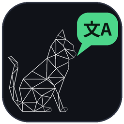

<p align="center">
  
</p>

<h1 align="center">Pancracio Studios · Programas</h1>

<p align="center">
  Programas gratuitos para Windows · Free programs for Windows<br>
  <a href="https://pancracio-studios.github.io/pancraciostudios-projects/"><b>Ver el catálogo · See the catalog</b></a>
</p>

---

## Programas · Programs

| | Programa | Versión | Descripción | Descarga |
|---|---|---|---|---|
|  | [Live Translator](programs/live-translator/) | 1.0.0 | Traduce en vivo el texto de tu pantalla (juegos, páginas, documentos). | [Instalador](https://github.com/pancracio-studios/pancraciostudios-projects/releases/download/live-translator-v1.0.0/LiveTranslator-Setup-1.0.0.exe) |

Todas las versiones e instaladores están en **[Releases](https://github.com/pancracio-studios/pancraciostudios-projects/releases)**.
All versions and installers are in **[Releases](https://github.com/pancracio-studios/pancraciostudios-projects/releases)**.

## Cómo está organizado · Layout

```
index.html                  Catálogo (página web)
catalog.json                Lista de programas que muestra el catálogo
assets/                     Estilos, logo y scripts de la página
programs/
  live-translator/
    index.html              Página del programa
    README.md               Resumen
    docs/                   Documentación (guía de uso, problemas comunes)
    installers/<versión>/   Instalador de cada versión + SHA256SUMS.txt
    versions/               Notas de cada versión
    CHANGELOG.md            Historial de cambios
    PRIVACY.md              Privacidad del programa
    img/                    Ícono y capturas
LICENSE.md                  Términos de uso (todos los programas)
PRIVACY.md                  Privacidad general
PUBLICAR.md                 Cómo agregar un programa o una versión nueva
```

Cada instalador se guarda en `programs/<programa>/installers/<versión>/` y, al subirlo, una automatización
publica su **Release** (`<programa>-v<versión>`) con las notas de la versión y la huella SHA-256
para comprobar que el archivo es original.

## Apoyar · Support

Todo es gratis y seguirá siéndolo. Si algo te sirvió y quieres apoyar para que salgan más programas:
Everything is free and will stay free. If something helped you and you'd like to support more programs:

<a href="https://ko-fi.com/pancraciostudios"><b>☕ Apoyar en Ko-fi · Support on Ko-fi</b></a>

## Antes de instalar · Before installing

Los instaladores no están firmados con un certificado de pago, así que Windows puede mostrar
**«Windows protegió tu PC»**. Haz clic en **Más información → Ejecutar de todas formas**.

Installers are not signed with a paid certificate, so Windows may show **"Windows protected your PC"**.
Click **More info → Run anyway**.

---

<p align="center">
  © 2026 Pancracio Studios · <a href="LICENSE.md">Términos de uso</a> · <a href="PRIVACY.md">Privacidad</a> ·
  <a href="mailto:pancraciostudios@gmail.com">pancraciostudios@gmail.com</a>
</p>
