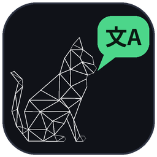
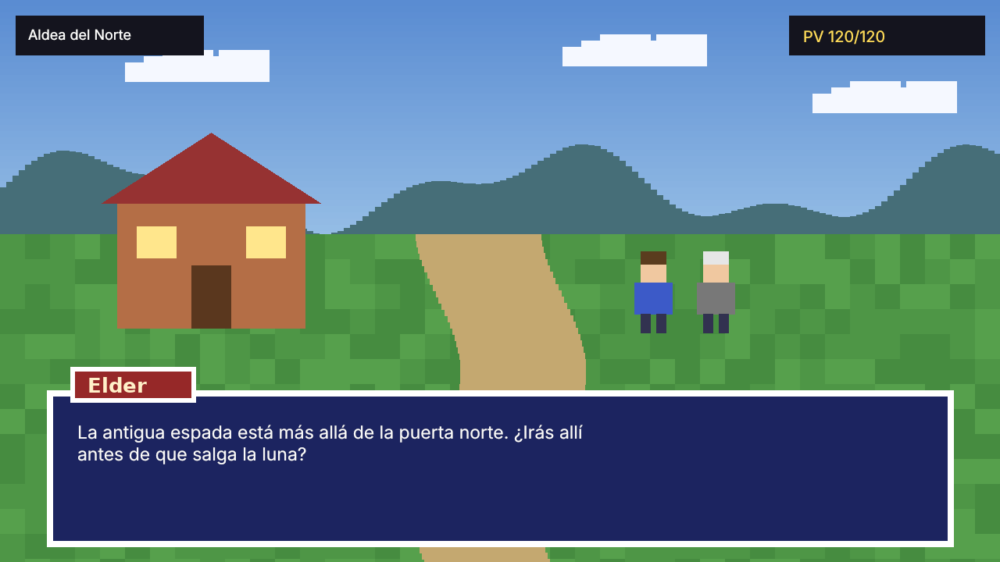

<h1 align="center">Live Translator</h1>

  Traduce en vivo el texto de tu pantalla y lo muestra en el mismo lugar. 
  <i>Translates on-screen text live and shows it in the same place.</i>

  <a href="https://github.com/pancracio-studios/pancraciostudios-projects/releases/download/live-translator-v1.0.0/LiveTranslator-Setup-1.0.0.exe"><b>⬇ Descargar v1.0.0 (Windows, 50 MB)</b></a> ·
  <a href="https://pancracio-studios.github.io/pancraciostudios-projects/programs/live-translator/">Página</a> ·
  <a href="https://ko-fi.com/pancraciostudios">☕ Apoyar</a>

## Qué hace

Live Translator lee el texto de una **pantalla, ventana o región** (un juego, una página, un PDF…),
lo traduce y lo muestra **en la misma posición**:

- **Vista espejo**: en otro monitor ves el original con el texto ya traducido. Sirve con 2, 3 o más pantallas.
- **Overlay (una sola pantalla)**: una capa transparente encima del original que no estorba: los clics pasan
  al juego y, al pasar el mouse sobre una traducción, ves el texto original.
- **40+ idiomas**, de cualquiera a cualquiera.

## Documentación

| | |
|---|---|
| [Guía de uso](docs/guia-de-uso.md) | Instalación, primeros pasos, todas las opciones |
| [User guide (English)](docs/user-guide.md) | Installation and quick start |
| [Problemas comunes](docs/problemas-comunes.md) | Avisos de Windows, OCR de idiomas, límites de traducción |
| [Versiones](versions/) · [CHANGELOG](CHANGELOG.md) | Qué cambió en cada versión |
| [Privacidad](PRIVACY.md) | Qué datos se envían y a quién |

## Requisitos

- Windows 10 (versión 2004 o más nueva) u 11, 64 bits.
- Internet para los traductores en línea (Google, Microsoft o DeepL).
- Para leer japonés, chino, coreano u otros: el paquete de OCR de ese idioma (la app ofrece instalarlo).
