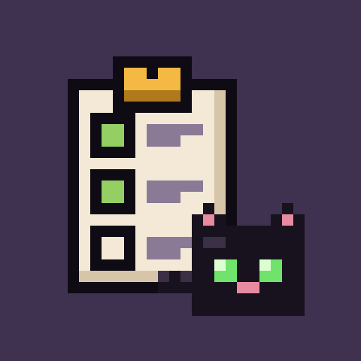

<h1 align="center">Pixel To-Do</h1>

  Tus pendientes como un juego pixel para Android · Your to-do list as a pixel game for Android 
  <a href="https://play.google.com/store/apps/details?id=com.pancraciostudios.pixeltodo"><b>Google Play</b></a> ·
  <a href="https://pancracio-studios.github.io/pancraciostudios-projects/programs/pixel-todo/">Página · Page</a>

- Misiones y hábitos con XP, oro, rachas y checklist.
- Ciudad Pixel con más de 40 construcciones, vecinos y ciclo de día y noche.
- Tienda de accesorios para tu avatar y logros con premios.
- Recordatorios, widget y respaldo en la nube con Google Play Juegos.
- Gratis, sin anuncios y sin compras.

[Política de privacidad · Privacy policy](https://pancracio-studios.github.io/pixel-todo/privacy/) ·
[Términos · Terms](https://pancracio-studios.github.io/pixel-todo/terms/)

La app se distribuye por Google Play; el código fuente es privado.
The app is distributed through Google Play; the source code is private.
